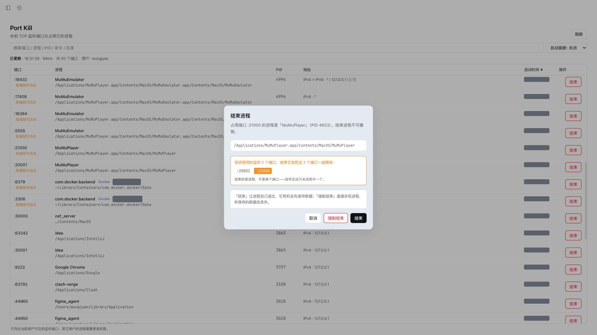

# Port Kill

[中文](README.md) | **English**

> See which process holds any TCP port on this machine — and end it only after confirming it is still the same process.

A DeepSeek Harness (DSH) plugin. One entry in the left sidebar, one full page in the middle listing every TCP listener on the machine; each row says which process it is, which directory it runs from, and when it started. Before you press **End**, it re-scans the port to confirm you are still looking at the same process.



## Relationship to the original

The original is [wungjyan/port-kill](https://github.com/wungjyan/port-kill) — a macOS desktop app built with Tauri 2, Vue 3 and Rust. It runs on its own and does not need DSH.

**If all you want is a small Mac tool that scans ports and ends processes, [download the client from Releases](https://github.com/wungjyan/port-kill/releases) — no DSH required.**

This repository is the DSH plugin version: the UI moved into DSH's web interface, next to the editor, the terminal and the agent; the verification logic and the sort order are unchanged. The desktop app is macOS-only; the platform layer exists only here.

## Features

**The list**

Port, process name, PID, listen address, start time. The second line of the process cell is the working directory — the home directory collapses to `~`, paths under it keep their relative path, anything outside keeps the last two segments. Two processes both named `node` are told apart by that line alone.

Click any row to expand it: full command line, working directory, every listen address, owning user, protocol and state, start time.

**Search and sort**

The search box matches port, process name, PID, command line, working directory and listen address. Port, process and start time are sortable; click again to reverse.

**Only what needs attention is marked**

An orange **Reachable on LAN** tag appears only when the port is open to the local network; hovering explains the listen address and how to go back to loopback-only. Loopback-only is the normal case and is not labelled row by row.

**Auto refresh**

Pick 3 / 5 / 10 / 15 / 30 / 60 seconds or off from the toolbar; 10 seconds by default. **Refresh** is there whenever you want it.

**Theming**

Light and dark follow DSH. No separate switch.

## What happens before a process is ended

Pressing **End** opens a confirmation dialog with the port, process name, PID and command line. Once confirmed, the Host side:

| Check | Why it refuses |
| --- | --- |
| Is this PID DSH itself, or an ancestor of it? | Ending it would close the window you are looking at |
| Is the PID ≤ 1? | System process |
| Is the port still held by this PID? | The list is stale; refresh and try again |
| Is the owning user still the current user? | Cannot end another user's process |
| Is the process name unchanged? | The list is stale |
| Is the start time unchanged? | The PID was reused |

Start time is the only field that separates "the same PID number" from "the same process", so when it is missing or unreadable the plugin **refuses** instead of skipping — skipping would be giving up the check.

On Windows, "owning user" and "process name" are not compared: `netstat` reports neither, and comparing empty values would refuse every single request. There the binding is PID plus start time. Windows also **refuses** when it cannot read the process parent chain (`503 self-check-unavailable`) rather than reading it as "this process has no ancestors", which would switch self-protection off.

**End** sends `TERM`, giving the process a chance to save its work; **Force end** sends `KILL`. A short paragraph in the dialog spells out the difference; **End** is the filled button and takes focus by default, **Force end** is outlined only.

**A process holding several ports is called out first.** A signal goes to a process, not to a socket, so ending one process releases every port it listens on. WeChat with 8 ports or an IDE with 4 is common, so the dialog lists every affected port and highlights the one you clicked.

**After a successful end, the port is checked for a new owner.** Watchers, `nodemon` and service managers grab the freed port again. That is not an error, but you need to know who holds it now.

## Docker

A port published by Docker is forwarded on the host by `com.docker.backend`, so the row names the forwarding process, not the container. The row carries a `Docker · container` badge, and the details give the image and the compose project.

The **End** button on those rows does **not** send a signal — ending the forwarding process does not stop the container, it only breaks forwarding and affects the container's other published ports. Clicking it opens an explanation: what the container is, which image, and where to stop it.

On Windows the forwarding process is `com.docker.backend.exe`, and the loopback half (`[::1]:3306`) is forwarded in by WSL's `wslrelay.exe`, so one published port shows up as two rows: one on `0.0.0.0`, one on `[::1]`. Neither sends a signal; the `wslrelay.exe` row gets the WSL explanation rather than Docker's — ending it only breaks WSL's port forwarding.

## Install

Search for **Port Kill** in the DSH plugin market, or from the command line:

```bash
dsh plugin --profile web add @wungjyan/dsh-port-kill
```

**Restart DSH once** after installing — a new bundle layer only loads on restart.

A local directory works too: **Plugins** → **Add plugin** → pick the repository directory. That is a link, not a copy, so the directory must not be moved or deleted afterwards.

Once installed, the sidebar shows **Port Kill**.

## Settings

Plugins page → Port Kill → Settings. Stored in `~/.dsh/port-kill/settings.json` and survives a restart.

- **Sidebar name**: follow the interface language / always Chinese (端口管理) / always English (Port Kill). Applied immediately
- **Auto-refresh interval**: 3 / 5 / 10 / 15 / 30 / 60 seconds or off

A file rather than browser storage: DSH picks a different port on every launch, and browser storage is scoped per origin, so it would be lost on the next start.

## The two agent tools

The plugin registers two DSH tools backed by the same implementation as the UI:

| Tool | What it does |
| --- | --- |
| `port_list` | Lists ports, filterable by port, process name, command, … |
| `port_kill` | Ends a process; requires `confirm: true`; returns every affected port |

`port_kill` goes through the same checks as the UI. The agent's list and the user's list come from the same scan, so "the UI is stale" and "the model misremembered" are the same class of problem, caught by the same check.

## Platform support

| Platform | Status | Ports from | Process detail from |
| --- | --- | --- | --- |
| macOS | tested | `lsof` | `ps` |
| Linux | tested | `lsof` | `ps` |
| Windows | tested (Windows 11) | `netstat -ano` | PowerShell `Get-CimInstance` |

A few things Windows cannot do, and the plugin does not pretend otherwise:

- **The owning account is unknown.** `netstat` sees listeners of other accounts and of system services but does not say whose they are, and there is no way to ask without elevation. The field stays empty rather than attributing every port to the current account — that would be a lie on exactly the system-service rows
- **The working directory is unknown.** Reading another process's cwd needs debug privileges
- **There is no catchable `SIGTERM`.** Both buttons terminate the process outright, and the dialog says so
- **Identity is PID plus start time.** User and process name cannot be read on Windows, so those comparisons are skipped rather than run against empty values

An unsupported platform (`sunos`, `aix`, …) answers with an explicit "no port scanner for this platform" instead of an empty list. An empty list would claim the machine has no listeners, when in fact nothing was read.

## Known limitations

- **Only listeners visible to the current user (macOS / Linux).** Without root, `lsof` cannot see other uids' sockets; on the development machine this hid two ports. Windows uses `netstat`, which sees every account's listeners but cannot say whose they are. The original app has the same limit; lifting it needs sudoers or a privileged helper, which a plugin cannot install
- **Root processes cannot be ended.** The result is `EPERM`, shown as "no permission", no crash
- **macOS `ps -o lstart` output is locale-dependent** and prints the month as `5月` under a Chinese locale. The original app could not verify start times because of this; the plugin passes `LC_ALL=C` to `ps` and fixes it

## Development

Zero runtime dependencies, hand-written JavaScript, no build step.

```bash
npm test        # node --test
npm run check   # node --check
```

```
host.js              Host side: HTTP routes, identity verification, agent tools
client.js            Client side: panel, sidebar entry, settings page
settings.js          Reading, validating and writing settings
platforms/
  exec.js            execFile wrapper (timeouts, buffer, empty-result exit codes)
  parse.js           Pure parsers shared by every platform
  posix.js           macOS / Linux
  win32.js           Windows
  docker.js          Docker attribution
  index.js           Backend selection and capability flags
cordis.patch.yml     Mounts the Host side as one profile loader row
```

Release notes live in [CHANGELOG.md](CHANGELOG.md).

## License

MIT
